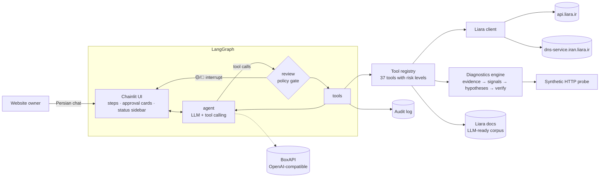

# Liara Ops Assistant · دستیار لیارا

**An AI teammate that sets up, deploys, monitors and troubleshoots websites on [Liara](https://liara.ir).**
Built for the StarCoach Agentic AI hackathon, Liara challenge, by team **Human in the Liara**.

> **خلاصه فارسی:** دستیاری گفت‌وگومحور (فارسی) که با API واقعی لیارا پروژه را تحلیل و دیپلوی می‌کند، پلن مناسب
> پیشنهاد می‌دهد، وضعیت و منابع (رم، CPU، دیسک)، لاگ‌ها و رویدادها را پایش می‌کند، و برای خطاهایی مثل ۵۰۰ یا کندی
> شواهد را جمع می‌کند، علت‌ها را رتبه‌بندی می‌کند، راه‌حل پیشنهاد می‌دهد و **بعد از تأیید کاربر** اجرا و نتیجه را
> بررسی می‌کند. اقدامات حساس (ری‌استارت، تغییر پلن، دیپلوی، متغیرهای محیطی) فقط با تأیید شما انجام می‌شوند و حذف
> منابع کاملاً مسدود است.

🎥 **Demo video:** _add link here_ · 📄 **Design doc:** [docs/implementation-plan.md](docs/implementation-plan.md) · 🧪 **Live test report:** [docs/test-report.md](docs/test-report.md)

---

## What it does

| Area | What the user says | What the assistant does |
|---|---|---|
| **First deploy** | «این پروژه را دیپلوی کن» + folder path or .zip | Detects platform and port, reads `liara.json`, recommends a plan + feature bundle with monthly cost, creates the app, sets env vars, packages and uploads the source, follows the build live, then tests the URL |
| **Releases** | «نسخه جدید را منتشر کن» | Same pipeline; on `FAILED`/`UNHEALTHY` it switches to troubleshooting automatically |
| **Monitoring** | «این برنامه را زیر نظر بگیر» | Background health checks (HTTP probe, RAM/CPU % of plan, disk, errors, restarts); alerts in chat with a one-click «🔍 عیب‌یابی کن» |
| **Troubleshooting** | «سایتم خطای ۵۰۰ می‌دهد» / «سایتم کند شده» | Collects evidence in parallel → extracts signals with rules → ranks hypotheses with confidence and evidence → proposes a fix → **asks for approval** → executes → **verifies before/after** |
| **Domains** | «دامنه example.ir را وصل کن» | Liara DNS zone, exact nameservers for nic.ir (manual step), record creation, domain check, SSL |

## User interface

The chat UI follows a design system generated with [UI UX Pro Max](https://github.com/nextlevelbuilder/ui-ux-pro-max-skill)
(`design-system/human-in-the-liara/MASTER.md`, with chat-page overrides in `pages/chat.md`): Minimalism & Swiss style,
trust blue `#2563EB` with an orange call-to-action `#EA580C`, Plus Jakarta Sans + Vazirmatn (Persian, RTL), light theme
by default, Lucide icons only (no emoji icons), visible focus states and reduced-motion support.

| Element | What the user sees |
|---|---|
| Welcome screen | Team logo (**Human in the Liara**) and four quick-start actions |
| `ApprovalCard` | Risk badge, the exact action, why (evidence), downtime, monthly cost change, how to undo, collapsible API details, **Approve / Reject** |
| `SecretInput` | Private password-style field for secrets: the value goes to Liara only, never to the chat, the LLM or the logs |
| `StatusPanel` (side panel) | Per-app RAM/CPU meters, HTTP status and latency, monitoring state, and a timeline of recent audited operations |
| `AlertCard` | Proactive monitoring alert with a one-click **عیب‌یابی کن** (diagnose) |

## Architecture



* **`agent`**: the LLM (BoxAPI, OpenAI-compatible) reasons and requests tools. It replies in Persian.
* **`review`**: the human-in-the-loop gate. Every 🟡/🔴 tool call becomes an approval card (action, reason with
  evidence, downtime, cost change in Toman/month, how to undo it). The graph pauses with LangGraph `interrupt()`
  until the user approves or rejects.
* **`tools`**: runs approved and auto tools, refuses rejected and blocked ones, masks secrets and writes the audit log.
* The policy is enforced **in code**. Text inside logs can't change it, which also neutralises prompt injection
  hidden in application logs.

### Risk levels

| Level | Behaviour | Tools |
|---|---|---|
| 🟢 read | runs automatically | `list_apps` `get_app_status` `account_overview` `list_plans` `recommend_plan` `analyze_project` `get_logs` `get_metrics` `get_events` `list_releases` `probe_website` `diagnose_app` `verify_fix` `check_health` `list_domains` `check_domain` `get_dns_zone` `list_dns_records` `search_liara_docs` `show_audit_log` |
| 🔵 low | runs automatically, shown in timeline | `issue_ssl` `check_dns_zone` `watch_app` |
| 🟡 medium | one-click approval | `deploy_project` `set_env_vars` `update_port` `set_zero_downtime` `add_domain` `create_dns_zone` `create_dns_record` |
| 🔴 high | approval with impact summary | `create_app` `restart_app` `start_app` `stop_app` `resize_app` `rollback_release` |
| ⛔ blocked | never executed | `delete_app` (and no other delete tools exist) |

### How the diagnosis works

1. **Evidence** (parallel, time-boxed): app state, plan, last releases, platform events, logs (secrets masked),
   CPU/RAM summary and time series, disk usage, and an HTTP probe of `https://<app>.liara.run`. Liara has no
   request-latency metric, so the assistant measures it itself.
2. **Signals** (deterministic rules, `diagnostics/signals.py`): e.g. `probe_5xx`, `missing_env` (env var named in
   logs but not set on the app), `errors_after_release`, `mem_high` / `mem_growing` / `log_oom`, `cpu_saturated`,
   `log_db_connection`, `log_module_missing`, `port_mismatch`, `disk_full`, `restarts`, `release_failed`.
3. **Hypotheses** (`diagnostics/engine.py`): scored causes (missing env, regression, memory, CPU, DB, dependency,
   port, disk, slow dependency, code exception), each with evidence and proposed tool calls (e.g. `restart_app`
   + `resize_app` to the next plan up, with the price difference).
4. **The LLM** explains the top causes in plain Persian and calls the fix tool, which opens an approval card.
5. **Verification** (`verify_fix`): waits for the app to settle, re-probes 3×, counts new error lines since the action,
   checks RAM/CPU, and compares with the saved baseline → ✅ fixed / ⚠️ partly / ❌ not fixed (next hypothesis).

## How it connects to Liara

* **Auth:** `Authorization: Bearer <LIARA_API_TOKEN>`. For team accounts, `?teamID=<LIARA_TEAM_ID>` is added to every
  request, as the official CLI does.
* **Base URLs:** `https://api.liara.ir` (PaaS) and `https://dns-service.iran.liara.ir` (DNS).
* Endpoints follow Liara's [OpenAPI spec](https://github.com/liara-cloud/openapi) and the official
  [CLI](https://github.com/liara-cloud/cli), which is the reference for the deploy and logs flow:

| Purpose | Endpoint |
|---|---|
| Account, plan catalogue | `GET /v1/me`, `GET /v1/me/free-credit`, `GET /v1/billing` |
| Apps | `GET/POST /v1/projects` (`{name, planID, platform, bundlePlanID, network}`), `GET /v1/projects/{name}`, `GET/POST /v1/networks` |
| Actions | `POST /v1/projects/{name}/actions/restart`, `.../actions/scale` `{scale: 0/1}`, `POST /v1/projects/{name}/resize` `{planID}` |
| Settings | `POST /v1/projects/update-envs` (full list: the assistant merges with existing envs), `POST /v1/projects/update-port`, `POST /v1/projects/{id}/zero-downtime/{enable/disable}` |
| Deploy | `POST /v2/projects/{name}/sources` (multipart .tar.gz, ≤256 MiB) → `POST /v2/projects/{name}/releases` → `GET /v2/releases/{id}/build-logs?since=` + `GET /v1/releases/{id}` |
| Observability | `GET /v2/projects/{name}/logs?start=&direction=forward`, `GET /v1/projects/{name}/metrics/{summary,cpu,memory}`, `GET /v1/projects/{name}/events`, `GET /v1/projects/{name}/releases` |
| Domains | `GET/POST /v1/domains`, `GET /v1/domains/{id}/check`, `POST /v1/domains/provision-ssl-certs` |
| DNS | `GET/POST /api/v1/zones`, `GET /api/v1/zones/{zone}`, `PUT /api/v1/zones/{zone}/check`, `GET/POST /api/v1/zones/{zone}/dns-records` |

## Limitations (the assistant states these to the user)

* **Registrars (nic.ir) have no API.** The nameserver change is a manual step; the assistant gives exact values and re-checks.
* **Liara metrics are CPU / RAM / network / disk only.** There are no request-latency or HTTP-status metrics, so the
  assistant uses its own HTTP probe and log analysis.
* **Metric units aren't documented.** From a live app we observed: memory is in bytes per container; CPU is
  CPU-seconds over a trailing 5-minute window (cores = value / 300); and after a restart the old container keeps
  reporting its last value for a few minutes. The assistant therefore reads the newest container's series and
  judges a fix only from samples taken after the action. `scripts/smoke_test.py` prints raw samples to re-check.
* **New-generation (g2) plans need a private network,** and not every feature bundle is offered for every plan
  (e.g. no `free` bundle on `small-g2`). The assistant picks or creates a network and only offers available bundles.
* **Health-check limits:** Liara rejects `healthCheck.startPeriod` above 3000; the demo uses the documented values.
* **Log retention depends on the feature bundle** (Free: last hour), so older evidence may be missing.
* **Scaling is vertical only** (plan resize) plus on/off. There is no autoscaling API.
* **Rollback** isn't in the official OpenAPI spec (`/v2/projects/{app}/releases/{id}/rollback` is used by a
  community MCP). If it fails, the assistant suggests redeploying the previous source.
* **`update-envs` replaces the whole list**, so the assistant always merges with the current envs first.
* `.env` files are **never uploaded** with the source. Env values are never shown on cards or written to the audit log.
* LLM diagnoses are probabilistic. They're always shown with evidence and confidence, and every fix is verified.

## Run it

```bash
python -m venv .venv && source .venv/bin/activate      # Windows: .venv\Scripts\activate
pip install -r requirements.txt
cp .env.example .env                                     # fill LIARA_API_TOKEN, LIARA_TEAM_ID, LLM_API_KEY
python scripts/smoke_test.py                             # read-only check of Liara + BoxAPI; picks a model
chainlit run app.py -w                                   # http://localhost:8000
python -m pytest                                         # offline tests (mocked Liara + scripted LLM)
```

**LLM:** BoxAPI (`https://ai.boxapi.ir/ai/v1`), default `gpt-5.6-sol` with fallbacks `gpt-5.6-terra,gpt-5-mini`.
Run the smoke test to see which models on your key support tool calling, then set `LLM_MODEL` accordingly.

## Demo scenario (`demo-app/`)

A small Express shop with labelled, simulated failure modes:

| Trigger | Effect | Expected diagnosis |
|---|---|---|
| Deploy without `DATABASE_URL` | home page and `/api/orders` return **500**; logs say `DATABASE_URL is not set` | `missing_env` (+ `errors_after_release`) → ask for value → `set_env_vars` → verify ✅ |
| `GET /api/leak?mb=100` (repeat) | RAM climbs toward the plan limit | `memory` → `restart_app` (short-term) + `resize_app` (cost shown) → verify |
| `GET /api/cpu?ms=8000` (repeat) | CPU saturates, site slows | `cpu` → resize / optimise |
| `LEAK_PER_REQUEST_MB=5` env | gradual leak under traffic | `mem_growing` |

Suggested flow for the video (about 5 minutes):
1. «پروژه demo-app را دیپلوی کن» → plan recommendation → approve → live build → URL.
2. Site shows 500 → «سایتم خطای ۵۰۰ می‌دهد» → diagnosis → give the DB URL → approve → ✅ verified.
3. Hit `/api/leak` a few times → «سایتم کند شده» → memory diagnosis → approve restart / resize → before/after.
4. «demo-shop را زیر نظر بگیر» → monitoring alert → audit log → limitations.

## Project layout

```
app.py                         Chainlit UI: streaming, tool steps, approval cards, status sidebar, monitor loop
liara_assistant/
  config.py                    .env settings
  liara/client.py              async Liara API client (auth, teamID, retries, friendly errors)
  liara/parse.py               response parsing, metric normalisation, plan catalogue
  tools/registry.py            @tool decorator, risk levels, JSON schemas
  tools/liara_tools.py         the 37 tools
  policy.py                    approval cards, secret-safe args, audit log
  agent/graph.py               LangGraph: agent → review (interrupt) → tools
  agent/prompts.py             system prompt (procedures + limitations)
  agent/llm.py                 BoxAPI chat model with fallbacks
  deploy/packager.py           platform/port detection, ignore rules, .tar.gz
  deploy/pipeline.py           upload → release → build tracking
  diagnostics/                 evidence, signals, hypotheses, verification
  probe.py                     synthetic HTTP checks
  plans.py                     plan recommendation
  data/liara_docs_index.json   index of Liara's LLM-ready docs (for search_liara_docs)
demo-app/                      breakable Express demo site + liara.json (health check)
scripts/smoke_test.py          read-only connectivity + model check
tests/                         17 offline tests (mocked API, scripted LLM)
```
