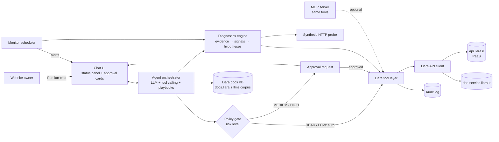
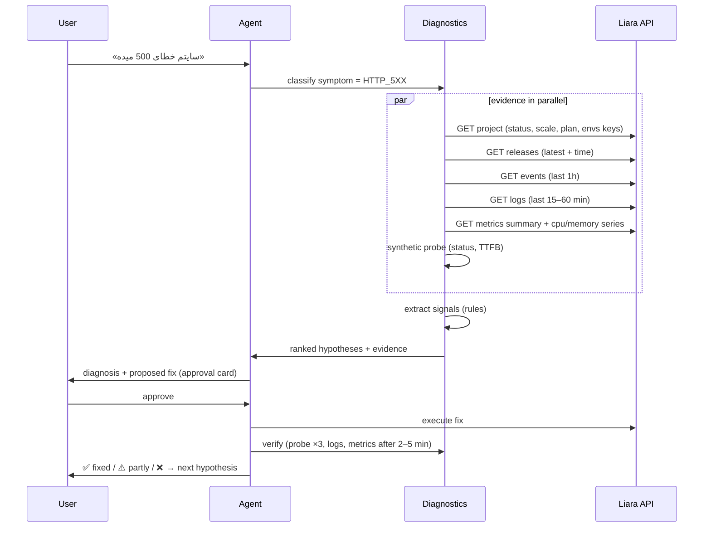

# Liara Challenge: Implementation Plan

**دستیار هوشمند راه‌اندازی، دیپلوی و پایش وب‌سایت با زیرساخت لیارا**
An AI assistant that sets up, deploys, monitors and troubleshoots websites on Liara.

| | |
|---|---|
| Hackathon | StarCoach Agentic AI, Liara challenge (challenge #9) |
| Team | Human in the Loop |
| Deadline | **1 Aban 1405, 23:50** (Fri, 23 Oct 2026, Tehran time) |
| Submission | Public demo-video link + GitHub repo link. **You can submit only once.** |
| Scoring | 300 points: Technical/Liara integration 100 · Intelligence 100 · UX 50 · Ops & security 50 |

> **About the intro video:** it's a 3:16 talking-head explanation with no slides, screen recording or captions. I couldn't transcribe the narration, so this plan is based on the written challenge statement. Watch the video once yourselves in case it includes spoken hints that aren't in the text.
>
> **About the API facts:** endpoints below were checked against Liara's official OpenAPI spec (`github.com/liara-cloud/openapi`) and the official CLI source (`github.com/liara-cloud/cli`). Items marked ⚠️ are unverified and need a quick test before you rely on them.

---

## 1. The challenge in one paragraph

Build an assistant that works like a technical teammate for a website owner on Liara. It should pick the right plan and get the first deploy done, ship new releases, keep watch on health (CPU/RAM, logs), and when something breaks (HTTP 500, slowness) collect evidence, rank likely causes, propose a fix, run it **only after approval when it is risky**, and verify the result. The format is up to you (AI agent, MCP server, or both; chat UI, CLI or custom UI). The deliverables are a working **MVP** that shows one real scenario end to end, a **README.md** on GitHub, and a **~5-minute demo video** (required: no video, no judging).

---

## 2. Requirements checklist (mapped to scoring)

### 2.1 Initial setup & first deploy · *Technical (100)*
- [ ] Detect the project type and guide the user to the right deploy method
- [ ] Analyse resource needs → recommend a Liara **hardware plan + feature bundle**
- [ ] Create the app, set env vars, upload the source, deploy, and track the build
- [ ] Guide domain setup, including the steps in the registrar panel (e.g. IRNIC / nic.ir)
- [ ] The user does only the steps the assistant **can't** do itself

### 2.2 Deployment & operations · *Technical (100)*
- [ ] Publish new versions (releases)
- [ ] Configure and manage the service through Liara APIs (envs, restart, plan, settings)
- [ ] Check service status and detect deploy errors (build failed, unhealthy, timed out)
- [ ] Automate repetitive operations

### 2.3 Monitoring & maintenance · *Ops (50)*
- [ ] Health + resource usage (CPU, RAM, disk, network)
- [ ] Fetch and analyse logs
- [ ] Investigate slowness, outages, rising resource usage
- [ ] Suggest performance and stability improvements
- [ ] Take corrective action or guide the user

### 2.4 Intelligent troubleshooting · *Intelligence (100)*
For an incident such as HTTP 500:
- [ ] Gather related information from every available source
- [ ] Inspect logs, service status and resource data
- [ ] Identify and **prioritise** probable causes
- [ ] Propose a fix
- [ ] With permission, apply it **and verify the result**

### 2.5 Human-in-the-loop · *UX (50) + Ops (50)*
- [ ] Approval before sensitive actions (risky config changes, restart, plan/resource change)
- [ ] A clear split between auto-run low-risk actions and approval-gated ones
- [ ] Operation results and errors are visible to the user

### 2.6 Constraints
- [ ] Use **only capabilities Liara's API actually has**; when something isn't available via API, **say so clearly** to the user
- [ ] Architecture, tools and UI are your choice

---

## 3. Recommended architecture



**Components**

| Layer | Responsibility |
|---|---|
| **Liara API client** | Typed wrapper over `api.liara.ir` and `dns-service.liara.ir`: auth, `teamID`, retries, timeouts, error mapping |
| **Tool layer** | One function per operation (list apps, deploy, logs, metrics, restart…). Each tool declares a **risk level**. The same tools are exposed to the agent and, optionally, as an MCP server |
| **Policy gate** | Enforced **in code**, not by the LLM. Decides auto vs. approval vs. forbidden. Writes every call to the audit log |
| **Agent orchestrator** | LLM with tool calling plus deterministic **playbooks** (first deploy, release, health check, troubleshoot, domain). The LLM handles conversation, reasoning and explanations; playbooks keep critical flows reliable |
| **Diagnostics engine** | Collects evidence in parallel, extracts signals with rules, then has the LLM rank hypotheses over a compact evidence summary |
| **Synthetic probe** | Your own HTTP checks (status code, TTFB) against `<app>.liara.run` or the custom domain. This fills the gap: Liara gives no request-latency metrics |
| **Knowledge base** | Liara's LLM-ready docs (`https://docs.liara.ir/all-links-llms.txt`, including each platform's *fix-common-errors* pages) for RAG during troubleshooting |
| **Monitor scheduler** | Periodic health checks + thresholds → alerts; auto-runs only LOW-risk actions |
| **UI** | Persian RTL chat, a live status panel, operation timeline, and approval cards |

**Suggested stack** (optimised for a ~36-hour build):
- **Backend:** Python 3.12 + FastAPI + `httpx`. Use **LangGraph** for the agent, since its `interrupt()`/resume pattern maps directly onto approval gates. Use APScheduler for monitoring.
- **LLM:** any OpenAI-compatible endpoint with tool calling. Using **Liara AI** (`https://ai.liara.ir/api/{workspaceID}/v1/chat/completions`) keeps the whole solution on Liara and reachable from Iran. The hackathon's BoxAPI credit is an alternative.
- **UI:** Chainlit (built-in step display + action buttons) is the fastest option. A small Next.js page gives more control over RTL.
- **MCP (bonus):** wrap the same tool layer with the official MCP SDK (FastMCP) so it also works in Claude Desktop or Cursor.
- **Dogfooding:** deploy the assistant itself on Liara. It's a good line for the demo.
- *Alternative for a Java team:* Spring Boot + Spring AI (tool calling + MCP server support). It's workable, but the approval/resume flow takes more manual work than LangGraph.

---

## 4. Liara API integration

### 4.1 Authentication
- Create an API token in the Liara Console (API section).
- Send it on every request: `Authorization: Bearer <API_TOKEN>`
- For team accounts, the official CLI adds `?teamID=<team-id>` to **every** request. Do the same.
- Base URLs: PaaS `https://api.liara.ir` · DNS `https://dns-service.liara.ir` · AI `https://ai.liara.ir`
- **Never pass the token to the LLM.** Keep it server-side (env var / secret store).

### 4.2 Endpoint map (what you'll actually use)

**Account & plans**
| Method | Path | Use |
|---|---|---|
| GET | `/v1/me` | User info **and the plan catalogue**: `plans.projects[planID]` → `RAM.amount`, `CPU.amount`, `volume`, `price` (hourly; ×720 ≈ monthly), `available`, `region`; `plans.projectBundlePlans[planID][free\|basic\|standard\|pro]` → `displayPrice`. ⚠️ The structure is undocumented; the CLI reads it this way |
| GET | `/v1/me/free-credit`, `/v1/billing`, `/v1/me/subscription` | Credit/billing checks before cost-changing actions |

**Apps**
| Method | Path | Use |
|---|---|---|
| GET | `/v1/projects` | List apps |
| GET | `/v1/projects/{name}` | Details: status, `scale`, `planID`, envs, `isDeployed`, node, `hourlyPrice`… |
| POST | `/v1/projects` | Create app `{name, planID, platform, bundlePlanID, network?, readOnlyRootFilesystem?}` |
| POST | `/v1/projects/{name}/actions/restart` | Restart |
| POST | `/v1/projects/{name}/actions/scale` | `{scale: 1}` on / `{scale: 0}` off |
| POST | `/v1/projects/{name}/resize` | Change hardware plan `{planID}` |
| POST | `/v1/projects/update-envs` | `{project, variables:[{key,value}]}` ⚠️ test whether it merges or replaces |
| POST | `/v1/projects/{id}/zero-downtime/{status}` | Also `default-subdomain`, `fixed-ip`, `read-only` |
| GET/POST | `/v1/projects/{id}/disks`, `…/disks/{name}/backups` | Disks & backups |

**Deploy**
| Method | Path | Use |
|---|---|---|
| POST | `/v2/projects/{name}/sources` | multipart `file` = `.tar.gz` of the source (max **256 MiB**) → `{sourceID}` |
| POST | `/v2/projects/{name}/releases` | `{sourceID, type, port, platformConfig, healthCheck, build, envs, message, gitInfo, disks, cron, args}` (or `{image}` for a Docker image) → `{releaseID}` |
| GET | `/v2/releases/{releaseID}/build-logs?since=<ts>` | Stream build output |
| GET | `/v1/releases/{releaseID}` | `release.state`: `BUILDING → PUSHING → PUSHED → DEPLOYING → READY`, or `FAILED` / `UNHEALTHY` / `TIMEDOUT` / `CANCELED` |
| POST | `/v2/releases/{releaseID}/cancel` | Cancel a build |
| GET | `/v1/projects/{name}/releases?page=1&count=10` | History + `currentRelease` |
| POST | `/v2/projects/{name}/releases/{id}/rollback` | ⚠️ Used by a community MCP server, **not** in the official spec. Fallback: redeploy the previous release's source |

**Observability**
| Method | Path | Use |
|---|---|---|
| GET | `/v2/projects/{name}/logs?start=<unix>&direction=forward&last_lines=<bool>[&releaseId=]` | Runtime logs (the CLI uses this). Response: `data[].metaData.releaseId` + `values[[timestamp, line]]` |
| GET | `/v1/projects/{name}/logs?since=<ts>` | The older variant in the spec |
| GET | `/v1/projects/{name}/metrics/summary` | Current `cpuUsage`, `memoryUsage`, `disksUsage{size, usage}` |
| GET | `/v1/projects/{name}/metrics/{cpu\|memory\|network-receive\|network-transmit}?since=<ts>` | Time series `{result:[{values:[[ts,val]], applet}]}` |
| GET | `/v1/projects/{name}/events?start=&end=&search=` | Platform events (deploys, restarts, crashes) |
| WSS | `wss://api.liara.ir?token=…&cmd=/bin/bash&project_id=…` | Shell into the container. **High risk**: allowlisted read-only commands, behind approval only |

**Domains & DNS**
| Method | Path | Use |
|---|---|---|
| POST | `/v1/domains` | Attach a domain `{name, project, type:"PROJECT"}` → `domain._id` |
| GET | `/v1/domains/{id}/check` | Status, `certificatesStatus`, verification info |
| POST | `/v1/domains/provision-ssl-certs` | `{domain}`: issue SSL |
| POST | `/v1/domains/{id}/set-redirect`, DELETE `/v1/domains/{id}` | Redirect / remove |
| POST/GET | `dns-service…/api/v1/zones`, `/zones/{zone}` | Liara DNS zone |
| PUT | `dns-service…/api/v1/zones/{zone}/check` | Check that the nameservers have switched |
| CRUD | `dns-service…/api/v1/zones/{zone}/dns-records[/{id}]` | Create/edit records automatically |

### 4.3 Deploy pipeline (same flow as the official CLI)
1. **Detect the platform** from files: `package.json` (+`next` → next, react/vue/angular), `composer.json` (laravel/php), `requirements.txt` (django/flask/python), `go.mod`, `*.csproj` (dotnet), `Dockerfile` (docker), `index.html` only (static). Supported types: `node, laravel, php, python, django, flask, dotnet, react, angular, vue, static, docker, next, go`.
2. **Detect the port** (framework defaults, or ask the user) and propose a `healthCheck` (`curl --fail http://localhost:<port>`).
3. **Recommend a plan** from `/v1/me` (§6.1).
4. **Create the app** (approval: it costs money) → **set envs** (from a `.env` the user pastes, with a key-only preview).
5. **Package** a `.tar.gz` honouring `.liaraignore` / `.gitignore`; refuse anything over 256 MiB.
6. **Upload** → `sourceID` → **create the release** → `releaseID`.
7. **Track** build logs + state live in the UI. On `FAILED` or `UNHEALTHY`, hand off to the troubleshooting playbook automatically.
8. **Verify**: probe `https://<app>.liara.run` (Liara's default subdomain) and report.

### 4.4 Domain flow (.ir example)
The assistant can't log into nic.ir, so that's the one manual step. Everything else is automated.

- **Option A (recommended, most automated): Liara DNS**
  1. Create a zone via the DNS API.
  2. Tell the user exactly which nameservers to set in nic.ir, with step-by-step instructions.
  3. Poll `PUT /zones/{zone}/check` until it's active.
  4. Create the required records via the API.
  5. Run `GET /v1/domains/{id}/check` until it's green.
  6. Call `provision-ssl-certs`.
- **Option B: existing DNS provider (Cloudflare / ArvanCloud)**
  1. Attach the domain.
  2. Show the three records Liara needs: `ALIAS/CNAME` (routing), `TXT` (ownership), `CNAME` for the DNS-01 challenge (SSL).
  3. Poll the check endpoint.
  4. Issue SSL. With Cloudflare, turn Universal SSL off, issue on Liara, then turn it back on.

---

## 5. Tool catalogue & human-in-the-loop policy

The **policy gate runs in code**. The LLM can *request* any tool, but only the gate decides whether it runs. This also neutralises prompt injection hidden in logs (log lines are untrusted text).

| Risk | Behaviour | Tools |
|---|---|---|
| 🟢 **READ** | Auto-run, shown in the timeline | list/get apps, metrics, logs, events, releases, build logs, domain check, plans, credit/billing, synthetic probe, docs search |
| 🔵 **LOW** | Auto-run + notify, reversible, no downtime/cost | provision SSL, re-check domain/NS, create a disk backup, cancel a stuck build the user started |
| 🟡 **MEDIUM** | One-click approval | deploy a new release to a live app, update envs (causes a restart), attach a domain, create DNS records, enable zero-downtime / health check |
| 🔴 **HIGH** | Approval with a full impact summary | restart, scale off, **resize plan** (cost change), create app (cost), rollback, edit/delete existing DNS records, shell commands |
| ⛔ **BLOCKED in MVP** | Refused; explain how to do it in the console | delete app / disk / database / zone |

**Each approval card shows:**
- **What** will happen (exact API call, in plain Persian)
- **Why** (the evidence that led to it)
- **Impact**: downtime? cost change in Toman/month (computed from `/v1/me` plan prices)
- **Reversibility + rollback plan**
- Approve / Reject / Modify buttons, plus an expiry (stale approvals are not executed)

**Other safety rules**
- Redact secrets before anything reaches the LLM: env **values**, tokens and passwords in logs (regex masks). Only send env **keys**.
- Audit log: who approved what, when, the request/response, and the outcome. Show it in the UI.
- Idempotency + a confirmation step for anything that changes cost.

---

## 6. How it works: the main flows

### 6.1 First deploy (onboarding)
```
User: «می‌خوام سایتم رو روی لیارا بالا بیارم» + repo zip / git URL
 → Detect platform, port, build needs                         [auto]
 → Ask 2–3 plain questions: expected visitors/day, DB needed? custom domain?
 → Recommend plan: hardware (e.g. Earth/Mars/Jupiter…) + bundle (free/basic/standard/pro)
   with the reasoning and monthly cost                        [explained]
 → Create app                                                 [🔴 approval: cost]
 → Set envs (key-only preview)                                [🟡 approval]
 → Upload + release, live build logs in the timeline         [🟡 approval]
 → On READY: probe <app>.liara.run → "your site is live"     [auto]
 → Offer domain setup (§4.4) and enable health check / zero-downtime
```
**Plan heuristic (starting point):** static/SPA → smallest plan; Node/Python/PHP with low traffic → 1 GB RAM; Laravel/Django with a DB and moderate traffic → 2 GB; anything that's memory-heavy in metrics later → recommend a resize. Hardware tiers per the Liara docs: Earth 0.5 GB/0.5 core · Mars 1 GB/1 core · Jupiter 2 GB/1 core · Saturn 4 GB/2 cores · Uranus 8 GB/4 · Neptune 16 GB/8 · Pluto 32 GB/16. Always read live availability and prices from `/v1/me`.

### 6.2 New release
Upload → release → track → verify. If the new release fails, or error rate/latency jumps right after it, propose a **rollback** (🔴), using the previous `READY` release from the release history.

### 6.3 Monitoring loop (every N minutes)
- Probe the URL (status + TTFB), `metrics/summary`, error-line count in the last window, recent events
- Thresholds: memory > 85% of plan RAM, CPU ≈ plan cores for over 5 min, disk > 85%, probe non-2xx, error rate spike
- On a breach: open an **incident** in the UI with a pre-collected evidence pack and offer "investigate"
- Recurring automation: scheduled disk backups, SSL/domain re-checks, daily health digest

### 6.4 Intelligent troubleshooting (the 100-point part)



**Step 1: Evidence collection.** Run in parallel and time-box it (about 10 s).

**Step 2: Signal extraction (deterministic rules).** This makes the diagnosis explainable and repeatable:

| Signal | Source | Likely cause | Proposed fix |
|---|---|---|---|
| Memory ≥ 90% of plan RAM, or restart/OOM events | metrics, events | Memory pressure / leak | Restart (short-term, 🔴), resize plan (🔴), point to the leak |
| CPU ≈ plan cores for a sustained period | metrics/cpu | CPU throttling | Resize, or optimise the hot path |
| Errors start right after the latest release | releases + logs timestamps | Regression in the new code | Rollback (🔴) |
| `ECONNREFUSED`, `ETIMEDOUT`, `could not connect` to the DB host | logs | DB down / wrong credentials | Check the DB service + `DATABASE_URL` env |
| `KeyError` / `undefined` env / "missing environment variable" | logs + env keys | Env var not set | Set env (🟡) → auto restart |
| `Cannot find module` / `ModuleNotFoundError` | build/runtime logs | Missing dependency | Fix the manifest, redeploy |
| Release `UNHEALTHY`, or probe 502 | release state, probe | Wrong `port` / app not listening / failing health check | Fix the port or health check, redeploy |
| `disksUsage` near size | metrics summary | Disk full | Clean up / resize disk |
| `scale = 0` or app stopped | project | App is off | Start (🔴) |
| High TTFB, but CPU/RAM normal | probe + metrics | Slow external dependency / DB queries | Code/DB advice, CDN for static assets |

**Step 3: Hypothesis ranking.** Send the LLM a compact evidence summary: signals, the top-5 error signatures with counts and first-seen time, metric peaks, release timeline, and relevant Liara docs snippets. **Don't send raw log dumps.** Ask for the top 3 causes with confidence and the exact evidence behind each. Rules provide the prior; the LLM explains and breaks ties.

**Step 4: Remediation + verification.** Execute the approved action, wait for state `READY`/running, re-probe 3×, compare metrics and error rate before vs after, then report the outcome. If it isn't fixed, move to the next hypothesis automatically.

**Example: slowness.** "My site is slow" → probe TTFB 4.2 s; memory 96% of 1 GB with a sawtooth pattern; 3 restart events in the last hour; no recent release.
→ #1 memory pressure/leak (high), #2 CPU (low: 30%).
→ Proposal: restart now (🔴) + resize to 2 GB (🔴, +X Toman/month), and fix the leak in the code.
→ After approval: TTFB 0.3 s, memory 40% → ✅.

---

## 7. UX design (50 points)
- **Persian, plain language.** The user describes the problem; the assistant handles the jargon.
- **Status panel** that's always visible: app state, current release, CPU/RAM gauges, domain/SSL status, last probe.
- **Operation timeline:** each step shows ⏳ → ✅/❌ with expandable details (API call, duration, error).
- **Approval cards** (§5) with Approve / Reject / Modify.
- **Explain recommendations:** each recommendation comes with "why" and "what happens if I don't".
- **Honest limits:** when the API can't do something, say so and give the exact manual steps (e.g. nic.ir).
- **Quick actions:** "Deploy latest", "Check health", "Show errors from the last hour", "Why is it slow?"

---

## 8. Limitations to declare (scored under Ops & security)
1. **Domain registrars (nic.ir etc.) have no API** → the user changes nameservers; the assistant gives exact values and polls.
2. **Metrics cover CPU / RAM / network / disk only.** There's no request latency, RPS or HTTP status-code metric → the assistant uses its own probes plus log parsing.
3. **Log retention depends on the feature bundle** (Free: last 1 hour; Standard: 30 days), so older evidence may be missing.
4. **Plan catalogue and prices** come from `/v1/me`, which has an undocumented structure that may change.
5. **Rollback** has no endpoint in the official spec (⚠️) → fallback is redeploying the previous source.
6. **Scaling is vertical only** (plan resize) plus on/off. There's no autoscaling API.
7. **Source archive ≤ 256 MiB**; some spec endpoints differ from what the CLI uses (e.g. logs v1 vs v2) → follow the CLI and test.
8. **Shell access** is powerful → restricted allowlist + approval, or disabled.
9. **LLM diagnoses are probabilistic** → always shown with evidence and confidence, and every fix is verified.

---

## 9. MVP scope & build plan (~36 hours left)

**Must-have (the demo depends on it):** API client, deploy pipeline, logs/metrics/events tools, policy gate + approvals, troubleshooting for 500 + slowness with verification, chat UI with status/timeline, README, video.
**Nice-to-have:** domain automation (fall back to guidance only), monitoring scheduler (fall back to an on-demand health check), MCP wrapper, rollback.

| Block | Hours | Output |
|---|---|---|
| 0 | 0–1 | Liara account + credit active, API token, a test app deployed manually to learn the flow |
| 1 | 1–5 | API client + READ tools; verified against the real app (logs v2, metrics, events, `/v1/me` plans) |
| 2 | 5–11 | Deploy pipeline (detect → plan → create → envs → archive → upload → release → track) + policy gate |
| 3 | 11–18 | Diagnostics engine: evidence collector, rules, LLM ranking, remediation + verify loop |
| 4 | 18–24 | UI: chat, status panel, timeline, approval cards, audit log |
| 5 | 24–28 | Domain flow + monitoring scheduler (or cut) |
| 6 | 28–32 | Demo app with fault injection, end-to-end rehearsal, README |
| 7 | 32–36 | Record the video, push the repo, submit (**one shot**: double-check both links are public) |

**Demo app (fault injection):** a tiny Express or Flask app:
- `GET /`: OK
- `GET /api/orders`: 500 when `DATABASE_URL` is missing (a realistic misconfiguration)
- `GET /leak`: allocates memory toward the plan limit
- `GET /cpu`: CPU-bound loop

Faults are switched on by deploying a "bad" release or by hitting the endpoints.

---

## 10. Demo video script (~5 min, show results, not code)

Video rules from the challenge:
- It is **required**; without it, the project isn't judged.
- Video quality affects the score.
- Narrate it if you can. A silent video is accepted but scores lower.
- No editing is needed. Present the work fully.

| Time | Scene |
|---|---|
| 0:00–0:30 | Problem + what the assistant is (one sentence), architecture diagram |
| 0:30–1:45 | «این پروژه رو دیپلوی کن» → platform detected → plan recommendation with cost → approval → live build → site is live on `liara.run` |
| 1:45–2:15 | Domain: attach → nic.ir instructions → check → SSL (or a pre-recorded result) |
| 2:15–3:30 | Bad release → «سایت 500 میده» → evidence collected → ranked causes (missing `DATABASE_URL` right after release vN) → approve env fix → restart → verified ✅ |
| 3:30–4:30 | «سایت کند شده» → memory at 96%, restart events → propose restart + resize (cost shown) → approve → before/after metrics |
| 4:30–5:00 | Monitoring alerts, audit log, declared limitations, closing |

---

## 11. Repo & README deliverable

```
liara-assistant/
├── README.md                # required deliverable (outline below)
├── docs/architecture.md     # diagrams from this plan
├── backend/
│   ├── liara/client.py      # auth, teamID, retries, error mapping
│   ├── liara/tools/         # apps, deploy, observability, domains, dns
│   ├── policy/gate.py       # risk levels, approvals, audit
│   ├── agent/graph.py       # LangGraph: playbooks + interrupts
│   ├── diagnostics/         # collectors, rules, ranking, verify
│   ├── monitor/scheduler.py
│   └── mcp_server.py        # optional
├── ui/                      # chat + status panel
├── demo-app/                # fault-injection app + liara.json
└── .env.example             # LIARA_API_TOKEN, LIARA_TEAM_ID, LLM_* (no real secrets)
```

**The README must include** (per the challenge): a short **architecture** section · **how it connects to Liara APIs** (auth, endpoints used) · **limitations** · **how the user interacts** (chat, approvals, statuses). Also add: setup/run steps, the demo scenario, and the video link.

---

## 12. Scoring self-check
| Criterion | Pts | Where it's covered |
|---|---|---|
| Technical & Liara integration | 100 | §4 API map, §4.3 deploy pipeline, §4.4 domains, management tools |
| Intelligence & problem solving | 100 | §6.4 evidence → signals → ranked hypotheses → fix → **verify** |
| UX | 50 | §7 Persian chat, status panel, timeline, approval cards |
| Stability, maintenance & security | 50 | §6.3 monitoring + automation, §5 policy gate/audit/redaction, §8 declared limits |

---

### References
- Challenge statement: starcoach.ir/hackathon/agentic-ai/challenges/9
- Liara OpenAPI spec: <https://github.com/liara-cloud/openapi> (`spec/paas.yaml`, `dns.yaml`, `me.yaml`) · rendered at <https://openapi.liara.ir>
- Liara CLI source, the reference deploy/log flow: <https://github.com/liara-cloud/cli>
- Liara docs, LLM-ready corpus: <https://docs.liara.ir/all-links-llms.txt>
- Community Liara MCP server (for ideas; unofficial): <https://github.com/razavioo/liara-mcp>
